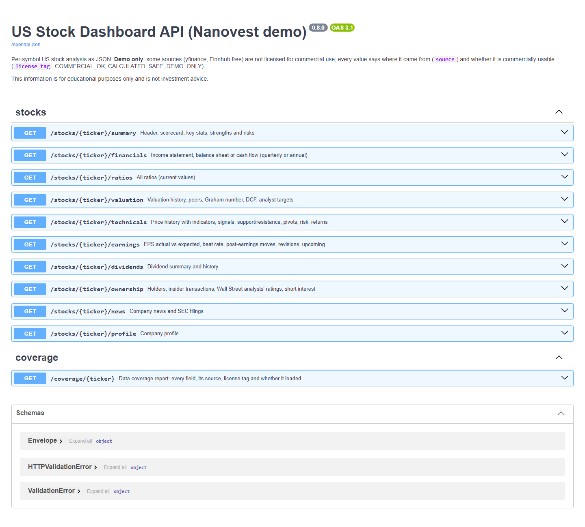

# US Stock Analysis Dashboard (Nanovest demo)

A working demo of a stock detail page for Nanovest: type a US ticker (for example `AAPL`) and get a full
dashboard. Every number shows where it came from and whether it may be used commercially. The same data is
also available as a JSON API for the mobile team. The full build spec is in `SPEC.md`; all 8 phases are done.

> This information is for educational purposes only and is not investment advice.

**What's in it**
- **Header:**
  - Price, market cap, 52-week range, next earnings date, data freshness.
  - 7 scorecard pills (Strong / Neutral / Weak).
- **Tabs:**
  - **Summary:** radar of the 7 scores, strengths and risks in plain language, key stats vs peers, 1-year chart with support/resistance, Wall Street analysts' view (labeled as third-party).
  - **Price & Technicals:** candlesticks, volume, RSI, MACD, moving averages, Bollinger Bands, support/resistance, pivots, earnings markers; trend signals stated as facts; returns vs SPY and the sector ETF; beta, volatility, drawdowns, Sharpe; monthly returns heatmap.
  - **Earnings:** 12 quarters of EPS actual vs expected, beat rate, price move after each report, GAAP vs adjusted EPS, revisions, the next report, links to SEC filings.
  - **Financials:** income statement, balance sheet and cash flow from official SEC filings, quarterly or annual.
  - **Valuation:** ratios vs the stock's own 5-year history and peers; fair value estimates (Graham number, DCF with sliders, analyst targets).
  - **Profitability & Health:** ROE / ROA / ROIC, DuPont breakdown, Piotroski F-score, Altman Z-score, debt ratios.
  - **Dividends:** yield, payout ratios, dividend growth and streak, history. Companies without a dividend say so.
  - **Ownership & Sentiment:** holders, insider buying/selling, analysts' ratings, short interest.
  - **News & Filings:** company news and the SEC filings feed.
  - **Company Profile:** business description, company facts, clickable peers.
  - **Data Coverage:** every field, its source, its license, and whether it loaded.
- **Languages:** English and Bahasa Indonesia.
- **Production-safe mode:** hides everything that comes from demo-only data sources.



<!-- App screenshot: open the app, take a screenshot (Win+Shift+S), save it as docs/screenshots/summary.png,
     then uncomment the next line. (Automatic capture doesn't work: headless browsers stop before Streamlit finishes loading.)
 -->

---

## 1. Install (one time)

You need Python 3.11 or newer. Open a terminal in this folder (in VS Code: **Terminal → New Terminal**) and run:

```powershell
python -m venv .venv
.venv\Scripts\python -m pip install -r requirements.txt
```

## 2. Add your settings (API keys)

```powershell
Copy-Item env.template .env
code .env
```

In `.env`, fill in:

| Setting | What to put |
|---|---|
| `SEC_USER_AGENT` | App name + **your real email**. The SEC requires a contact email. |
| `FINNHUB_API_KEY` | Free key from https://finnhub.io (optional: leave empty to skip Finnhub) |
| `PRICE_PROVIDER` | `yfinance` for now (later `nanovest`) |
| `PRODUCTION_SAFE_MODE` | `true` hides all "Demo data" fields (app and API) |
| `LANGUAGE` | `en` or `id` (starting language; switchable in the sidebar) |

`.env` is private and is never shared (it is listed in `.gitignore`). `env.template` is the safe, shareable template.

## 3. Run the dashboard

```powershell
.venv\Scripts\python -m streamlit run app/streamlit_app.py
```

Your browser opens at http://localhost:8501. To stop it, press **Ctrl+C** in the terminal.

## 4. Run the API

```powershell
.venv\Scripts\python -m uvicorn api.main:app
```

Then open http://127.0.0.1:8000/docs. It's interactive documentation: click an endpoint, then **Try it out**, then **Execute**.

| Endpoint | What it returns |
|---|---|
| `GET /stocks/{ticker}/summary?lang=en` | Header, scorecard, key stats, strengths and risks |
| `GET /stocks/{ticker}/financials?period=quarterly&statement=income` | Statement rows (also `annual`; `balance`, `cashflow`) |
| `GET /stocks/{ticker}/ratios` | Every ratio, Piotroski checks, Altman Z |
| `GET /stocks/{ticker}/valuation?growth=0.08` | Valuation history, peers, Graham number, DCF (optional assumptions), analyst targets |
| `GET /stocks/{ticker}/technicals?range=1y` | Daily bars with indicators, signals, support/resistance, pivots, risk, returns |
| `GET /stocks/{ticker}/earnings` | EPS actual vs expected, beat rates, price moves, revisions, upcoming report |
| `GET /stocks/{ticker}/dividends` | Dividend summary and history |
| `GET /stocks/{ticker}/ownership` | Holders, insiders, Wall Street analysts' ratings, short interest |
| `GET /stocks/{ticker}/news?days=7` | Company news and SEC filings |
| `GET /stocks/{ticker}/profile` | Company profile |
| `GET /coverage/{ticker}` | Data coverage report |

How responses work:
- **Every value carries its origin:** `{"value", "source", "license_tag", "as_of", "derived", "na_reason"}`.
- **Safe mode:** add `?safe_mode=true` to any request to see it as production-safe mode would. Every `DEMO_ONLY` value becomes `null` with `"na_reason": "Requires a licensed data provider"`.
- **Errors:** an unknown ticker returns 404 with a friendly message; a bad parameter returns 422 with the allowed values.
- **Speed:** the first call for a ticker loads everything; later calls within 2 minutes take about 20–100 ms.
- **Windows tip:** use `127.0.0.1` rather than `localhost`. `localhost` adds about 2 seconds per call.

## 5. Run the tests

```powershell
.venv\Scripts\python -m pytest              # 122 fast tests, no internet needed
.venv\Scripts\python -m pytest -m network   # 61 live tests against SEC / Yahoo / Finnhub (about 2 minutes)
```

The live tests include the acceptance checks of every phase. Highlights:
- AAPL quarterly numbers match the official reports.
- KO's 63-year dividend streak is found.
- No buy/sell wording appears anywhere in our own text.
- Production-safe mode is audited: the whole app is rendered tab by tab, and every API response is scanned, to confirm no demo item is shown.

---

## Production-safe mode

Turn it on in the sidebar (or with `PRODUCTION_SAFE_MODE=true`). The app then shows only:
- 🟢 **Licensed-safe** data: SEC EDGAR, and the Nanovest price feed once connected.
- 🔵 **Calculated** data built only from licensed-safe inputs.

Every 🟠 demo item is replaced by "Requires a licensed data provider". That includes values *derived* from demo data, such as the Altman Z-score (it uses the demo price) and the DCF's analyst-based growth; in safe mode the DCF uses SEC-based growth instead. This shows exactly what the app looks like with free commercial data, and what a paid vendor would add. **`DATA_SOURCES.md`** lists every field with its suggested production replacement.

## Performance

| Situation | Measured |
|---|---|
| Cached load (ticker opened in the last 2 minutes, or its data is still in the disk cache) | **0.5–1.1 s** |
| Switching tabs / language / toggles | 0.2–1.5 s (only the selected tab is computed, using lazy tabs) |
| API call after the first one for a ticker | 20–100 ms |
| Completely cold first load (all caches for that ticker cleared) | 9–17 s, depending on the company and on Yahoo / SEC response times |

How the load is kept down:
- **Parallel loading:** sources load in parallel ([core/bundle.py](core/bundle.py)), and the financial statements start right away instead of waiting for the header.
- **Disk cache:** each source has its own cache, with the TTLs from SPEC Section 10.
- **Lazy tabs:** only the selected tab's code runs.
- **Timing logs:** `logs/app.log` has one timing line per source call, per loading step and per tab.

In normal use the SEC data (cached 24 hours) and profile data (7 days) are already stored, so a first visit of the day mostly refreshes prices.

---

## Where each field comes from

Every value shows a colored badge. Hover over the badge to see its source and date. The complete list, with
production replacements, is in **`DATA_SOURCES.md`** (generated from `core/coverage.py` by
`python scripts/make_data_sources.py`) and in the app's **Data Coverage** tab.

| Badge | Meaning |
|---|---|
| 🟢 **Licensed-safe** | SEC EDGAR or the Nanovest price feed: OK for commercial use |
| 🔵 **Calculated** | We calculated it only from licensed-safe inputs |
| 🟠 **Demo data** | From yfinance or Finnhub free tier, or calculated using them. **Demo only**, must be replaced by a paid vendor before launch |

| Field | Source (priority order) | License |
|---|---|---|
| Company name, exchange, SIC code, HQ, fiscal year end, state of incorporation | SEC EDGAR submissions | Licensed-safe |
| Shares outstanding | SEC EDGAR (dei:EntityCommonStockSharesOutstanding) | Licensed-safe |
| Data freshness (latest 10-Q / 10-K) | SEC EDGAR | Licensed-safe |
| Price, change today, 52-week range | Price provider (yfinance now, Nanovest later) | Demo data (yfinance) |
| Market cap | Price × SEC shares; Yahoo's value for multi-class companies (e.g. BRK) | Demo data (price is demo) |
| Sector, industry, description, employees, CEO | yfinance | Demo data |
| Logo, IPO date, website | Finnhub (website: SEC first, then Finnhub, then yfinance) | Demo data |
| Next earnings date | yfinance, then Finnhub | Demo data |
| Peers | Finnhub, then companies in the same Yahoo industry | Demo data |

### Financial statements (Financials tab)

| What | Source | License |
|---|---|---|
| Income statement, balance sheet, cash flow | SEC EDGAR XBRL "companyfacts" (official 10-Q / 10-K numbers) | Licensed-safe |
| Q4 values, single-quarter cash flow, EBITDA, FCF, margins, growth, ratios | Calculated by us from SEC numbers (marked ✱ in tables) | Calculated |
| Backup if SEC has no data | yfinance statements (only ~5 quarters / 4 years) | Demo data |

How the numbers are built (all in `core/financials.py`, tag lists in `config/xbrl_tags.yaml`):
- **Tags:** companies use different XBRL tags for the same item and change them over the years. For each period we use the first tag in the list that has a value.
- **Q4:** companies don't file a Q4 report. Q4 = full year − 9-month year-to-date, or full year − Q1 − Q2 − Q3.
- **Cash flow:** 10-Q cash flow is year-to-date, so a single quarter = this year-to-date − the previous year-to-date.
- **Q4 EPS:** Q4 net income ÷ Q4 diluted shares, not a subtraction.
- **Restatements:** when a period was reported more than once, we use the value the SEC marks as best for that period, otherwise the most recently filed one.
- **Data quality check:** the last 4 quarters of revenue, net income, operating cash flow and total assets are compared with yfinance. Differences above 2% are logged and listed at the bottom of the Financials tab.
- **Banks and insurers** (e.g. JPM, BRK.B): gross profit, EBITDA, current ratio and similar items show N/A with the reason.

### Ratios, valuation and scores (Valuation and Profitability & Health tabs)

| What | Inputs | License |
|---|---|---|
| ROE, ROA, ROIC, margins, debt ratios, CAGR, Piotroski F-score | SEC financial statements only | Calculated |
| P/E, P/S, P/B, EV/EBITDA, FCF yield, valuation history, Altman Z | SEC statements + **price** (yfinance now) | Demo data (becomes "Calculated" with the Nanovest price feed) |
| Forward P/E, PEG, analyst targets, DCF default growth | yfinance analyst estimates | Demo data |
| Peer ratios | Peer list from Finnhub, ratios from Yahoo Finance | Demo data |

Formulas are in `core/ratios.py`, `core/valuation.py` and `core/quality_scores.py`, each with unit tests in `tests/test_ratios.py`. A few rules worth knowing:
- **No look-ahead in valuation history:** each day uses only the financial results that had been filed with the SEC by that day.
- **Stock splits:** EPS and share counts filed before a split are adjusted. Without this, NVDA's 2024 10-for-1 split would make its old P/E look 10× too high.
- **Negative earnings:** P/E shows "N/A (negative earnings)", never a negative number.
- **Banks and insurers:** EV/EBITDA, ROIC, the Altman Z-score, the DCF and similar items show N/A with the reason.

### Price, technicals and risk (Price & Technicals tab)

| What | Inputs | License |
|---|---|---|
| Candles, moving averages, RSI, MACD, Bollinger Bands, ATR, volume, support/resistance, pivots, signals | Daily prices from the price provider (yfinance now) | Demo data (becomes "Calculated" with the Nanovest price feed) |
| Returns, beta, volatility, drawdown, Sharpe, monthly returns | Dividend-adjusted prices of the stock, SPY, the sector ETF (`config/sector_etfs.yaml`) and `^IRX` | Demo data |
| Earnings markers on the chart | yfinance earnings dates (beat / miss %) | Demo data |

The formulas are in `core/technicals.py` and `core/risk.py`, with tests on synthetic prices in `tests/test_technicals.py`. Notes:
- **RSI and ATR** use Wilder's smoothing, the method most charting tools use, so values match them.
- **Support and resistance** levels are built in four steps:
  - Find swing highs and lows (5 days on each side) over 6 months, 1 year or 2 years.
  - Add the window's highest high and lowest low, so a brand-new 52-week high counts even before it's confirmed.
  - Group prices within max(0.5 × ATR, 1.5% of price) into one level. A group never stretches wider than that tolerance.
  - Rank levels by touches, with recent and high-volume touches counting more. The 3 strongest above and below the price are kept.
- **Trend signals** are facts with dates ("price is above its 200-day average"), never advice.

### Earnings (Earnings tab)

| What | Source (priority) | License |
|---|---|---|
| EPS estimate, reported EPS (usually adjusted), surprise %, report date and time | yfinance, then Finnhub | Demo data |
| GAAP diluted EPS, actual revenue, fiscal quarter labels | SEC EDGAR | Licensed-safe |
| Revenue estimates | Finnhub (free tier: latest quarter only) | Demo data |
| Estimate trend (90/60/30/7 days ago, now), up/down revisions, next-quarter estimates | yfinance | Demo data |
| 10-Q / 10-K and 8-K press release links | SEC EDGAR (8-K item 2.02 = results of operations) | Licensed-safe |

Rules (in `core/earnings.py`, tests in `tests/test_earnings.py`):
- **Beat / miss / inline:** beat if the surprise is above +1%, miss if below −1%, otherwise inline.
- **Price reaction:**
  - If the company reports before the market opens, the move is measured from the previous day's close.
  - If it reports after the close (or the time is unknown), the move is measured from that day's close to the next trading day's close, and 5 days later.
- **Quarter labels:** each report is matched to the fiscal quarter that ended just before it. If the 10-Q isn't filed yet, the quarter is marked "(est.)".
- **Expected EPS** is shown with 3 decimals. Providers round the estimate to cents but calculate the surprise from the exact value, so $0.40 vs $0.40 can correctly be a −1.1% "miss".

### Dividends, ownership, sentiment, news

| What | Source (priority) | License |
|---|---|---|
| Dividend history, ex-dividend dates, yield | yfinance (split-adjusted) | Demo data |
| Payout ratio, FCF payout | Calculated from SEC dividends paid, net income and free cash flow | Calculated |
| Dividends declared per share (cross-check) | SEC EDGAR | Licensed-safe |
| Holders, top institutions, insider transactions, short interest, rating changes | yfinance | Demo data |
| Wall Street analysts' ratings by month | Finnhub, then yfinance | Demo data |
| News | Finnhub company news, then yfinance | Demo data |
| SEC filings feed (8-K, 10-Q, 10-K, Form 4, ...) | SEC EDGAR | Licensed-safe |

Rules (in `core/dividends.py` and `core/sentiment.py`, tests in `tests/test_dividends_sentiment.py`):
- **Pays a dividend** = last dividend within about 15 months. Otherwise the tab shows "This company does not pay a dividend".
- **Growth streak** = consecutive calendar years in which the highest *regular* payment went up. Payments above 1.5× the year's median count as special dividends and are ignored. This gives KO 63 years.
  - Yahoo's records from the 1960s–80s can be incomplete, so some very long streaks are undercounted (e.g. PG, JNJ).
- **Yield history** = last year of payments ÷ that day's price. "Last year of payments" means the last 4 payments for a quarterly payer, not a fixed 365-day window, which would spike when payment dates shift by a day.
- **Insider buys and sells** count only open-market purchases and sales. Stock awards, gifts and option exercises are listed but not counted.

### Scorecard and insights (Summary tab)

- **Categories:** Valuation, Growth, Profitability, Financial health, Earnings quality, Momentum, Dividend.
- **Scores:** each category is scored 0–100 from several metrics.
  - **Strong** = 70+, **Neutral** = 40–69, **Weak** = below 40.
  - This is *our description of the data*, never a buy/sell recommendation.
- **Tuning without coding:** every threshold and weight is in `config/scoring.yaml`. Example: `revenue_yoy: {rule: higher_better, range: [-0.05, 0.15]}` gives 0 points at −5% growth and 100 points at +15%.
- **Missing data:** a category is scored from the metrics that are available ("based on 3 of 5 metrics"). With fewer than 2, it shows "Not enough data".
  - Banks get no Financial health score, because capital ratios aren't in free data.
  - Companies without a dividend show "Not applicable" for Dividend.
- **Strengths and Risks:** generated by rules in `config/scoring.yaml`, with up to 5 each, ordered by priority. The sentences are in `config/insights_en.yaml` and `config/insights_id.yaml`.
- **Production-safe mode:** metrics that use demo data (price, estimates, peers) are dropped, so scores use licensed-safe data only.
- **No buy/sell wording:** a test (`tests/test_scorecard.py`) checks that our texts contain none, in either language. Third-party analyst ratings appear only on the Ownership and Summary tabs, labeled "Wall Street analysts' ratings… not our view".
- **Interface text** (tabs, sidebar, header, summary) is in `config/ui_en.yaml` and `config/ui_id.yaml`; tooltips are in `config/glossary_*.yaml`.

## Project layout

```
SPEC.md              the build specification
DATA_SOURCES.md      every field: source, license tag, production replacement (generated)
config/              everything editable without coding
  settings.py          reads .env (keys, cache times, safe mode)
  xbrl_tags.yaml       SEC tags per financial line, in priority order
  scoring.yaml         scorecard thresholds, weights, strengths/risks rules
  sector_etfs.yaml     sector -> ETF benchmark
  glossary_*.yaml      tooltips (en / id)        insights_*.yaml   strengths/risks text (en / id)
  ui_*.yaml            interface text (en / id)
core/                data + calculation layer (no UI), reusable by Nanovest's real app
  providers/           base.py (interfaces), sec_edgar.py, yfinance_provider.py, finnhub_provider.py,
                       nanovest_price.py (stub), registry.py (source priority)
  models.py            every value carries source + license tag + as_of
  financials.py        SEC facts -> quarterly/annual statements, Q4 derivation, YTD fix, TTM
  ratios.py  valuation.py  quality_scores.py  technicals.py  risk.py  earnings.py  dividends.py  sentiment.py
  scorecard.py         pillar scores and strengths / risks
  coverage.py          the field catalog behind the Data Coverage tab, /coverage and DATA_SOURCES.md
  bundle.py            loads everything for one ticker in parallel (used by the app and the API)
  cache.py             disk cache (.cache folder) with per-ticker refresh
api/main.py          FastAPI endpoints (/docs)
app/                 Streamlit page (streamlit_app.py) and one component file per tab
scripts/             make_data_sources.py
tests/               unit tests (offline) and live acceptance tests (pytest -m network)
logs/app.log         one line per source call / loading step / tab with time taken
```

## Plugging in Nanovest's price feed later

Fill in the TODOs in `core/providers/nanovest_price.py`, then set `PRICE_PROVIDER="nanovest"` in `.env`.
If the Nanovest feed fails, the app falls back to yfinance automatically.

Every price-based number (ratios, technicals, risk, valuation history, Altman Z) then turns from 🟠 Demo data into
🔵 Calculated automatically, because the license tag is derived from the inputs.

## Known limitations

**Data**
- 42 of the 73 fields come from demo-only sources (yfinance, Finnhub free tier). They must be replaced before a commercial launch; see `DATA_SOURCES.md`.
- yfinance is unofficial and can fail or rate-limit. The app then shows "N/A" with a reason instead of crashing.
- Past revenue estimates need a paid provider; the free sources only cover the latest quarter.
- Banks and insurers:
  - Gross profit, EBITDA, ROIC, current ratio, the Altman Z-score, the DCF and the Financial health score show N/A with a reason.
  - Proper bank measures, such as capital ratios, aren't in free data.
- Multi-class companies (e.g. BRK) report shares per class, which the free SEC API doesn't split out, so their market cap uses Yahoo's number.
- MSFT and TSLA report only plain depreciation (no amortization), so their EBITDA is slightly understated.
- Very long dividend streaks can be undercounted (e.g. PG, JNJ), because Yahoo's records from the 1960s–80s are incomplete.
- Stock split dates come from yfinance.

**Differences with Yahoo's numbers**
- **Timing:** right after an earnings report, Yahoo may include the new quarter before the official SEC filing exists (e.g. NVDA in November 2026).
- **Definitions:** Yahoo counts leases as debt and uses a different ROA formula; JPM's and BRK's revenue are defined differently.
- **Where to see them:** the "Data check" panels on the Valuation and Financials tabs list these differences. SEC is the official source.
- **Peers:** peer ratios come from Yahoo, while the stock's own row uses our SEC-based calculation.

**App**
- In Bahasa Indonesia, detailed chart titles and table headers inside the deeper tabs are still English. Translated: tabs, sidebar, header, scorecard, strengths/risks and every tooltip.
- A completely cold first load of a ticker takes 9–17 s, above the 10 s target for some companies. Cached loads take under about 1 s.
- Peer fallback uses Yahoo industry groups. Same-SIC-code peers from the SEC would need a bulk SEC index.
- "Revenue bars + net margin line" is two stacked panels sharing a time axis, not one chart with two y-axes.
- `pydantic` is pinned to 2.12.5 because Windows Application Control blocked the newer version's compiled file on this PC.
- The README's app screenshot has to be taken by hand (see the note at the top).
